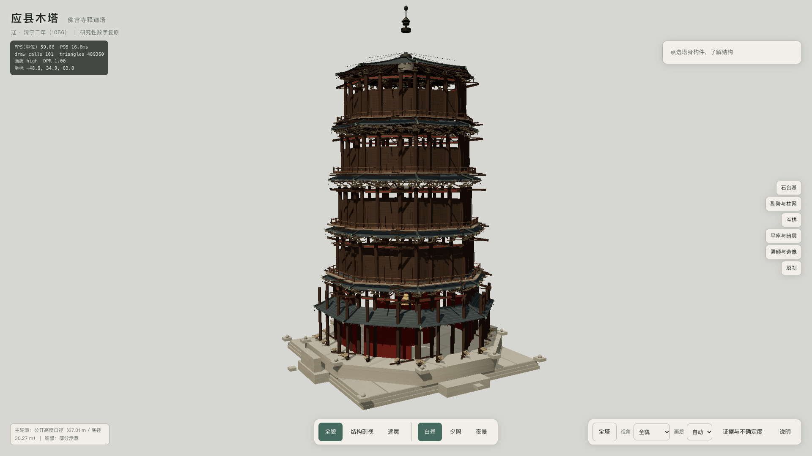

# 应县木塔 · 佛宫寺释迦塔 ｜ 实时三维数字展陈

> 山西朔州应县佛宫寺释迦塔（俗称**应县木塔**）的**程序化参数化复原**。
> 辽·清宁二年（1056 年）建，平面八角，外观五层六檐、明五暗四共九层，通高 67.31 m。
> 本页用 WebGL / Three.js 以**实时三维**呈现，可自由环绕、缩放、读构件、切剖面、切昼夜。



---

## 一、项目与文物身份

| 项 | 内容 |
|---|---|
| 文物 | 佛宫寺释迦塔（应县木塔），第一批全国重点文物保护单位，2013 年列入 UNESCO 世界遗产**预备名单**（编号 5803） |
| 形制 | 八角平面；外观五层**六檐**（第一层重檐）；明五暗四**共九层**；塔顶八角攒尖 + 铁刹 |
| 尺度 | 通高 67.31 m；底层直径 30.27 m；高径比约 2.22（敦厚而不失高峻） |
| 技术 | Three.js `0.186.1` + Vite `8.3.5`，无框架、原生 ES Module、零运行时第三方请求 |
| 性质 | **研究性数字复原**。几何、贴图、匾额文字全部由程序生成，不是文物扫描件 |

## 二、运行环境

- **Node.js**：Vite 8.3.5 要求 `Node 20.19+ / 22.12+`；本机锁定并实测于 **Node 26.0.0 / npm 11.12.1**
- **浏览器**：需 **WebGL2**（Three.js 自 r163 起不再支持 WebGL1）。本机实测 Chrome 155、Chromium（CDP + ANGLE Metal / Apple M5 Max）
- **显卡**：本机为 Apple M5 Max（Metal 4）。低性能设备会自动降档（见第八节）

## 三、运行

```bash
cd /Users/sheng/Projects/20261025040300-yingxian-muta-3d
npm ci          # 按 package-lock.json 精确安装
npm run dev     # 开发服务器 → http://127.0.0.1:5173
```

| 命令 | 作用 |
|---|---|
| `npm run dev` | 开发服务器（Vite，ESM 热更新） |
| `npm run build` | 生产构建 → `dist/`（相对路径 `base: './'`，可直接静态托管） |
| `npm run preview` | 预览构建产物 → http://127.0.0.1:4173 |
| `npm test` | 单元与结构自检（53 项，`node --test`） |
| `npm run check` | `npm test && npm run build` |

> **无 CI、无自动部署。** 仓库为 private，不配置也不触发任何 GitHub Actions；
> 任何发布/部署都需要另行取得授权。本项目默认**不**对外发布。

## 四、操作方式

| 输入 | 行为 |
|---|---|
| 左键拖拽 | 绕塔旋转（OrbitControls，带阻尼） |
| 滚轮 | 缩放（距离限制 12–185 m） |
| 右键拖拽 | 平移（目标点限制在塔周 ±14 m 内，不会飘离） |
| 单指拖 / 双指 | 触屏旋转 / 缩放平移 |
| `Tab` | 焦点遍历全部控件（焦点环 2 px `#456A5F`） |
| `Enter` / `Space` | 激活当前控件 |
| `R` | 返回全塔机位 |
| `1`–`5` | 聚焦第 1–5 明层 |
| `Esc` | 关闭说明面板 / 退出剖视与楼层聚焦 |

界面元素：左上标题、右上「构件注释」卡、下中「全貌｜结构剖视｜逐层」与「白昼｜夕照｜夜景」、
右下「全塔 / 视角 / 画质 / 证据与不确定度 / 说明」、右侧六个常驻构件热点、左侧五个楼层按钮。
所有状态变化都有可见反馈（`aria-pressed`、标题变化、动作），并通过 `aria-live` 中文播报。

## 五、尺寸口径与有争议的数值

完整尺寸登记表见 `src/data/dimensions.js`（M01–M43），每条记录都带
`valueM`（已核实/已公布）、`estimateM`（本项目估算）、`certainty`、`measurementDatum`（测线口径）与 `sourceIds`。
证据来源表见 `src/data/evidence.js`（H/T/V/L 四组）。机器可读版本见 `handoff/sflipcloop/reference-dimensions.json`。

**必须知道的口径问题：**

1. **67.31 m 与 30.27 m 是「公开口径」**，不是 2026 年的现状逐点实测。不同测线（对边距 / 对角径 /
   最远顶点距）不可互相比较——模型对每一处都标注了 `measurementDatum`。
2. **斗栱是「54 种」形制，不是「54 朵」**。2018 年中国土木工程学会《空间结构简讯》记为「54 种、480 朵」。
   本模型按逐层铺作实际布置生成，**台账实算**实例数与几何类别数并与文献数字并列陈述，
   不宣称精确重现 480 朵（见 `reports/bracket-ledger.json`）。
3. **省文物局原文「仰莲刹座 2.17 m + 铁刹身 9.95 m，总高 11.67 m」内部不自洽**（2.17+9.95=12.12≠11.67）。
   按陈明达 A 模数（1⅛A = 9.934 m 恰为铁刹身）解出：砖仰莲**含在 6A 塔身段之内**，不是叠加项。
4. **大量细部是估算值**：逐层柱高、檐口标高与出挑、斗口尺寸、椽瓦规格、匾额实尺、屋面举折折数、
   二层是否确有「铁柱」、「蚂蚱做法」与唐代叉手遗存的具体位置、现状歪斜与病害 —— 均标「估算 / 待核实」，
   界面上一律带「估算」徽标，**不冒充实测**。
5. **塔内造像为抽象雕塑占位**，按 H07 的组数与位置布置（1/5/4/7/9 共 26 尊），造型不是佛像复原。
6. **匾额为原创排版**（白底黑字，CanvasTexture），非原匾扫描；字体走系统中文回退链，无网络字体。

## 六、模型不是高精度测绘

> 本页模型由**程序化几何与原创程序纹理**生成，属**研究性复原**，
> **不是**经主管部门认证的毫米级现状数字孪生，**不适用于**工程修缮、结构安全评估或考古测量结论。
> 塔体按**原始设计的规整状态**呈现，不复制现状的倾斜（约北偏东 10.8°）与病害。
> 凡尚未证实的米制数字，在界面上都能看到「估算 / 待核实」标记。

## 七、资产与授权

**无任何外部模型、图片或字体文件**，因此没有运行时第三方请求，也没有授权不清的素材：

| 资产 | 来源 | 许可证 |
|---|---|---|
| 全部几何（八角柱网 / 斗栱分件 / 屋面举折 / 平座 / 塔刹 / 造像占位） | 原创程序生成 | 本项目原创 |
| 木纹、砖石、瓦面贴图 | 原创程序生成（固定 seed，可复现） | 本项目原创 |
| 匾额文字 | 原创 Canvas 排版 | 本项目原创 |
| 中文字体 | 系统字体回退（PingFang SC / Hiragino Sans GB / Noto Sans CJK SC / serif） | 系统自带 |
| Three.js 0.186.1 / Vite 8.3.5 | npm | MIT |

`references/photos/` 是**验收对照用**的 Wikimedia Commons 实拍照片（CC BY / CC BY-SA，逐张署名见
`references/photos/manifest.json`），**不打包进网页产物**。

## 八、WebGL2 与三档性能

- **基础平台**：WebGL2（`alpha: false`，`ACESFilmicToneMapping`，`SRGBColorSpace`）。
- **画质档**：高（DPR ≤ 1.75 / shadow 2048 / SSAO+SMAA）、中（DPR ≤ 1.35 / shadow 1024）、
  低（DPR ≤ 1.0 / 关阴影后期）、极简（DPR 0.7）。手动选择时不再自动升降档。
- **自动降级**：交互中持续 10 s 的帧时间 P95 > 30 ms 降一档、> 50 ms 直接到低端；
  回升需连续 20 s P95 < 阈值 × 0.75。
- **实测**：见 `reports/performance.md`（三档 × 5 场景，Apple M5 Max）。
- **优雅降级**：无 WebGL2 时给出完整分层文字简介；context lost 时显示遮罩并提示刷新；
  失焦暂停重计算；`prefers-reduced-motion` 下动画时长归零。

## 九、目录

```
index.html                     页面骨架与中文 UI
src/main.js                    启动、状态编排、渲染循环、调试接口
src/app/                       状态机 / 中文界面 / 无障碍 / 资产清单
src/data/                      尺寸登记、来源登记、拓扑结构、中文内容
src/geometry/                  八角几何、截面拉伸、构件库、斗栱、屋面、平座、台基、塔刹、造像、匾额
src/materials/                 程序木纹 / 砖石 / 琉璃 / 瓦面 / 天空
src/render/                    舞台、昼夜、相机、画质、后期、拾取、剖切、帧统计、资源保护
tests/                         53 项自检（尺寸 / 几何 / 斗栱 / 文案 / 状态机）
scripts/                       CDP 驱动（无新依赖）：出图、验收、比例校验
handoff/sflipcloop/            网页规划原文、本机审计、实测数据集、验收清单、执行报告
reports/                       验收证据（截图、性能、尺寸核对、台账、文案审计）
```

## 十、调试接口

带 `?debug=1` 打开时（开发模式自动开启）暴露 `window.__yingxianDebug`：
`getReadyState` / `getStats` / `getDimensions` / `getCounts` / `getBracketLedger` / `getSceneInfo` /
`setQuality` / `setView` / `setLight` / `goTo` / `jumpTo` / `spin` / `setSize`。
左上角实时显示中位 FPS、帧时间 P95、draw calls、三角形数、画质档与 DPR。

## 十一、验收

```bash
npm test                       # 53 项结构与文案自检
node scripts/verify-proportions.mjs --selftest   # 比例校验器自检（14 项 + 变异体拦截）
node scripts/acceptance.mjs    # 真浏览器验收：产出 reports/ 全部证据
node scripts/shots.mjs         # 仅出图
```

验收结论与逐项证据见 `handoff/sflipcloop/execution-report.md` 与 `reports/`。
